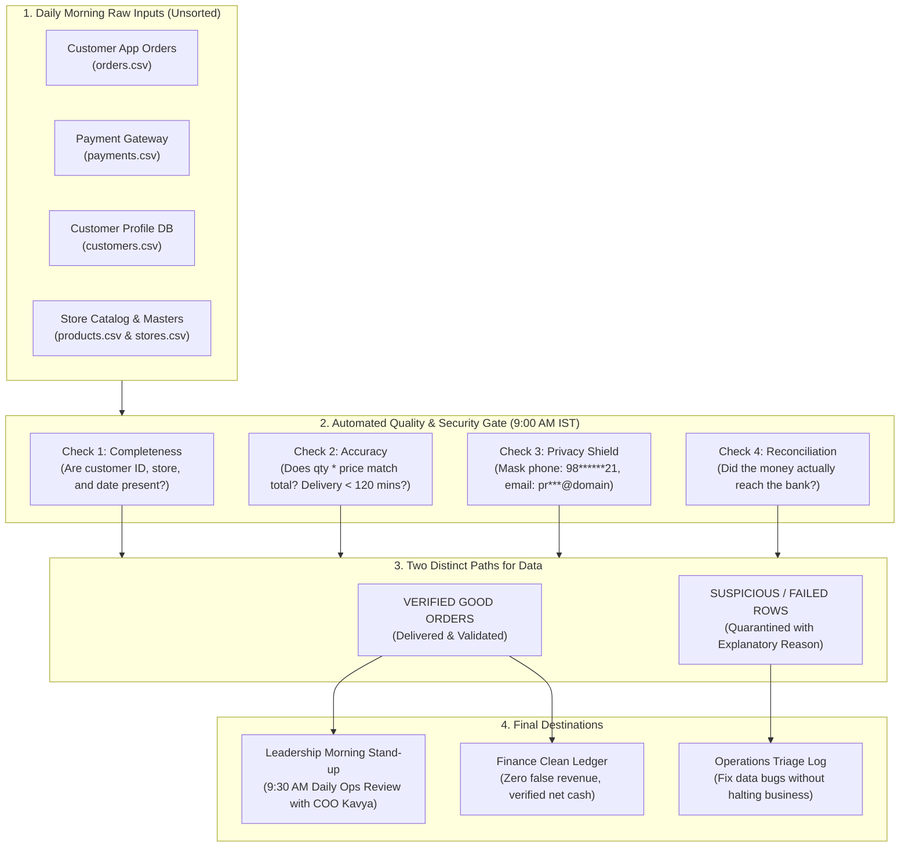
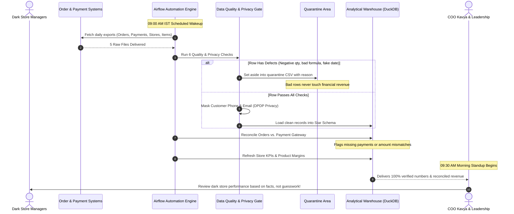
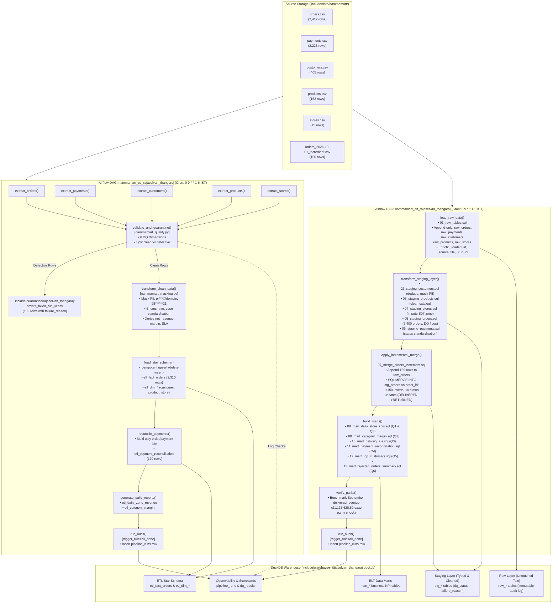
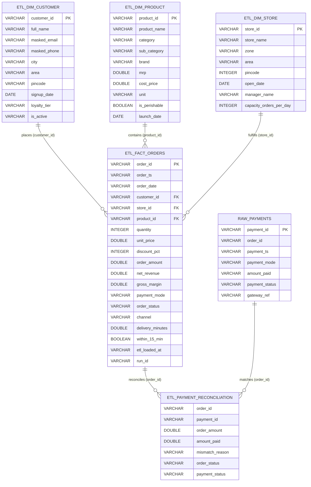
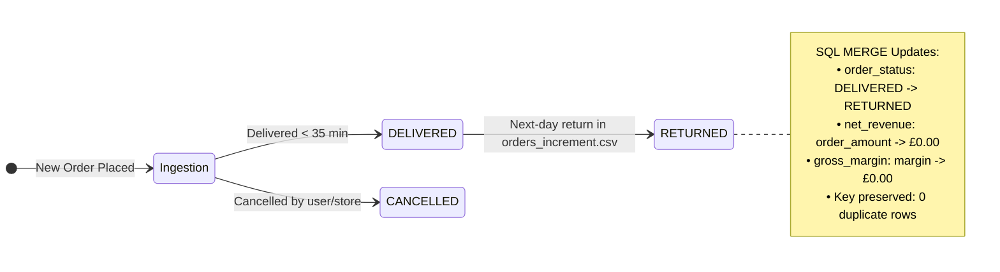

# NammaMart Quick Commerce — ETL & ELT Pipeline Project Submission

**Module:** FDAIE Module 2 · Data Engineering Foundations  
**Author:** Rajaselvan Thangaraj (`rajaselvan_thangaraj`)  
**Submission Date:** October 21, 2026  
**Repository:** [IIT_Roorkie_CEC_Futurenece_Data_Pipeline_to_ML_Model](https://github.com/UmashankarKH/IIT_Roorkie_CEC_Futurenece_Data_Pipeline_to_ML_Model)  

---

## Table of Contents
1. [Executive Summary & Client Brief](#1-executive-summary--client-brief)
2. [Part 0: Data Profiling & Issues Log](#2-part-0-data-profiling--issues-log)
3. [Part A: Build the ETL Pipeline](#3-part-a-build-the-etl-pipeline)
4. [Part B: Build the ELT Pipeline](#4-part-b-build-the-elt-pipeline)
5. [Part C: Scheduling & Production Timing](#5-part-c-scheduling--production-timing)
6. [Part D: Data Quality Scorecard Framework](#6-part-d-data-quality-scorecard-framework)
7. [Part E: Data Governance & Compliance](#7-part-e-data-governance--compliance)
8. [Part F: Observability Experiments](#8-part-f-observability-experiments)
9. [Part G: Recommendation to the CTO (ETL vs. ELT)](#9-part-g-recommendation-to-the-cto-etl-vs-elt)
10. [Answers to Six Core Business Questions](#10-answers-to-six-core-business-questions)
11. [Bonus Architecture Features](#11-bonus-architecture-features)

---

## 1. Executive Summary & Client Brief

### 1.1 Client Context
NammaMart Quick Commerce Pvt Ltd operates 15 dark stores across 4 zones in Bengaluru (North, South, East, West), delivering ~150 grocery items within 10–30 minutes. In September 2026, the company processed ~2,400 orders.

### 1.2 The Problem
Operations reviews led by COO Kavya began daily at 9:30 AM, but morning reports assembled manually from 5 unintegrated CSV exports were frequently delayed until 10:30 AM. Furthermore:
- **Financial Mismatches:** Order revenues persistently drifted from payment gateway settlements.
- **Metric Distortion:** Duplicate transactions and dummy test entries artificially inflated revenue; erroneous delivery durations (>15 hours) invalidated delivery SLA metrics.
- **Privacy Exposure:** Unencrypted customer phone numbers and email addresses were shared openly across spreadsheets.
- **Absence of Auditability:** Retroactive order returns were not reconciled back to historical figures.

### 1.3 Dual-Pipeline Mandate
To reconcile competing requirements between **Finance** (strict gatekeeping: zero invalid rows allowed into reporting tables) and **Analytics/Audit** (complete raw data preservation for historical replay), two production pipelines were built side-by-side on Apache Airflow and DuckDB:
1. **ETL Pipeline (`dags/nammamart_etl_rajaselvan_thangaraj.py`):** Pre-warehouse Python validation, automated quarantine with explicit error reasons, PII masking, and idempotent star schema loading.
2. **ELT Pipeline (`dags/nammamart_elt_rajaselvan_thangaraj.py`):** Raw immutable loading, pure-SQL staging transformations with DQ flags, automated incremental `MERGE`, and business-ready data marts.

### 1.4 Non-Technical Overview: How NammaMart Delivers Reliable Numbers by 9:00 AM

For business leaders, store managers, and ops coordinators, this diagram illustrates how raw, messy daily inputs are transformed into trustworthy, audit-ready numbers before the daily 9:30 AM review:



#### Daily Operating Sequence (Every Morning)
The sequence diagram below walks through the end-to-end timeline from raw export to morning stand-up:



### 1.5 Technical Architecture Diagrams

#### Technical Diagram 1: Dual Airflow DAG & Execution Engine Topology
This diagram details the task DAGs, XCom data structures, Python validation components, pure-SQL warehouse transformations, and DuckDB persistence models:



---

#### Technical Diagram 2: Data Warehouse Relational Model & Incremental Merge State Flow
This diagram details the Entity-Relationship structure of the Star Schema, the multi-way payment reconciliation join logic, and the incremental order state transitions:





---

## 2. Part 0: Data Profiling & Issues Log

### 2.1 Profile Summary across Files
A full programmatic profile of all 5,372 rows across the 6 dataset exports revealed data quality defects across every single file.

| File | Rows | Columns | Primary Key | Key Findings |
|---|---|---|---|---|
| `orders.csv` | 2,412 | 13 | `order_id` | 12 duplicate keys (24 rows), 18 null/missing customer IDs, 8 DELIVERED orders missing delivery minutes, 6 extreme delivery durations (>120m up to 1440m), 10 negative quantities, 15 formula calculation mismatches, 4 invalid date formats (`2026-13-05`, `31/09/2026`), 7 future-dated orders. |
| `payments.csv` | 2,228 | 7 | `payment_id` | 4 duplicate payment IDs, 301 null gateway references, 10 negative amounts, 7 future timestamps (2027), 8 orphan payments referencing non-existent order IDs, 22 amount mismatches vs orders. |
| `customers.csv` | 405 | 10 | `customer_id` | 5 duplicate customer IDs, 4 null emails, 12 malformed emails, 7 invalid phone numbers (<10 digits), 8 unstandardized loyalty tier casings, 3 future signup dates (2027). |
| `products.csv` | 152 | 10 | `product_id` | 2 duplicate product IDs with `(old)` suffixes, 3 null categories, 1 negative MRP (`-203.0`), 5 products where `cost_price > mrp`. |
| `stores.csv` | 15 | 8 | `store_id` | Store `S07` (NammaMart BTM Layout) missing `zone` value (imputed to South). |
| `orders_increment.csv` | 160 | 13 | `order_id` | 150 net-new orders for `2026-10-01` + exactly 10 status corrections updating historical September orders from `DELIVERED` to `RETURNED`. |

### 2.2 Data Issues Log

| File | Row Key / Sample | Column | Problem Description | Quality Dimension | Proposed Rule / Action | Severity |
|---|---|---|---|---|---|---|
| `orders.csv` | `ORD000539`, `ORD000783` | `order_id` | 12 duplicate order IDs across 24 rows | Uniqueness | Deduplicate: preserve first occurrence, quarantine duplicates | Critical |
| `orders.csv` | Rows 271, 897 | `customer_id` | 18 rows with missing / null customer IDs | Completeness | Reject and quarantine; order cannot be attributed | Critical |
| `orders.csv` | Rows 511, 1098 | `order_ts` | Invalid dates: Month 13 (`2026-13-05`) & Sept 31 (`31/09/2026`) | Validity | Reject invalid date formats; quarantine row | Critical |
| `orders.csv` | 10 rows | `quantity` | Negative quantity (-3, -2, -1) | Accuracy | `quantity > 0`; reject negative quantities | Critical |
| `orders.csv` | 15 rows | `order_amount` | Amount mismatch with `qty * price * (1 - disc)` | Accuracy | Recompute expected amount; quarantine if diff > 0.02 | Critical |
| `orders.csv` | 8 rows | `delivery_minutes` | `DELIVERED` status but `delivery_minutes` is NULL | Completeness | Delivered orders must have non-null duration | Critical |
| `orders.csv` | 6 rows | `delivery_minutes` | Duration > 120 minutes (up to 1440 min / 24 hours) | Accuracy | Cap SLA validity at 120 min; quarantine sensor outliers | Critical |
| `orders.csv` | `ORD002103` (250%) | `discount_pct` | Discount exceeds 100% | Validity | `discount_pct BETWEEN 0 AND 100` | Critical |
| `orders.csv` | 9 rows | `product_id` | IDs (`P9455`, `P9212`, etc.) not in product master | Consistency | FK verification; quarantine orphaned items | Critical |
| `orders.csv` | 5 rows | `store_id` | Store IDs (`S99`, `S17`, `S00`) not in store master | Consistency | FK verification; quarantine invalid stores | Critical |
| `orders.csv` | 10 rows | `payment_mode` | Casing/typos (`upi`, `UPI `, `CARD`, `Cashh`, `cod`) | Validity | Standardize to allowed enum: UPI, Card, Cash on Delivery, Wallet | Warning |
| `payments.csv` | 4 rows | `payment_id` | Duplicate payment IDs | Uniqueness | Primary key must be unique; quarantine duplicate | Critical |
| `payments.csv` | 8 rows | `order_id` | References orders not present in order master | Consistency | Reject orphan payments missing corresponding orders | Critical |
| `payments.csv` | 7 rows | `payment_ts` | Future-dated timestamps in year 2027 | Timeliness | `payment_ts <= CURRENT_TIMESTAMP`; reject future | Critical |
| `customers.csv` | 5 rows | `customer_id` | Duplicate customer IDs | Uniqueness | Deduplicate keeping most recently loaded record | Warning |
| `customers.csv` | 7 rows | `phone` | Phone numbers with fewer than 10 digits | Validity | Regex check `^\d{10}$`; flag warning and mask | Warning |
| `customers.csv` | 12 rows | `email` | Missing `@` symbol or invalid email domain | Validity | Regex format validation; flag warning | Warning |
| `customers.csv` | 8 rows | `loyalty_tier` | Inconsistent casing (`BRONZE`, `bronze`, `SILVER`) | Consistency | Standardize to Title Case (`Bronze`, `Silver`, `Gold`, `Platinum`) | Warning |
| `products.csv` | 2 rows | `product_id` | Duplicate entries with `(old)` naming | Uniqueness | Deduplicate by filtering out old variants | Warning |
| `products.csv` | 3 rows | `category` | Null category for launched products | Completeness | Impute to `'Unknown'` or quarantine | Critical |
| `products.csv` | `P0109` | `mrp` | Negative MRP (`-203.0`) | Accuracy | `mrp > 0`; reject and quarantine | Critical |
| `products.csv` | 5 rows | `cost_price` | `cost_price > mrp` (loss-making data entry error) | Accuracy | Flag warning in catalog audit | Warning |
| `stores.csv` | `S07` (BTM Layout) | `zone` | Null zone value | Completeness | Impute `'South'` based on Bengaluru geographic master | Warning |

### 2.3 Three Questions for the Client Before Building
1. **Handling Returns vs. Negative Quantities:** Are negative order quantities in `orders.csv` data-entry errors to be quarantined, or legitimate return adjustments? *(Recommendation: All returns must be recorded as positive quantities under `order_status = 'RETURNED'` linked to the original order ID).*
2. **Delivery SLA Thresholds:** If an order takes >120 minutes due to exceptional circumstances (e.g., severe weather or vehicle breakdown), should it be quarantined as bad data or retained with a special `SLA_BREACH` flag so store performance is not biased?
3. **Month-End Revenue Recognition Policy:** When an order delivered on September 30 is returned on October 1, should finance retroactively restate September revenue, or account for the return as an October adjustment? *(Finance standard practice requires keeping September sealed and booking the return in October).*

---

## 3. Part A: Build the ETL Pipeline

### 3.1 Architecture Overview
The ETL pipeline (`dags/nammamart_etl_rajaselvan_thangaraj.py`) executes using Airflow's TaskFlow API.
- **Extract:** 5 parallel tasks extract source CSVs into memory.
- **Validate:** Evaluates every row against the 6 Data Quality dimensions.
- **Quarantine:** Clean rows proceed; defective rows are segregated to `include/quarantine/rajaselvan_thangaraj/orders_failed_<run_id>.csv` with a comprehensive `failure_reason` column.
- **Transform:** Standardizes categorical text, masks customer email and phone, dedupes masters, joins dimension attributes, and computes derived fields (`order_date`, `net_revenue`, `gross_margin`, `within_15_min`).
- **Load (Star Schema):** Idempotently loads data into DuckDB warehouse `include/warehouse_rajaselvan_thangaraj.duckdb`.
- **Reconciliation:** Compares orders against `payments.csv` and outputs `etl_payment_reconciliation`.
- **Reporting:** Materializes `etl_daily_zone_revenue` and `etl_category_margin`.

### 3.2 Star Schema Structure
- **Fact Table:** `etl_fact_orders` (2,310 clean rows)
  - `order_id` (VARCHAR, PK)
  - `order_ts` (VARCHAR), `order_date` (VARCHAR)
  - `customer_id` (FK), `store_id` (FK), `product_id` (FK)
  - `quantity` (INT), `unit_price` (DOUBLE), `discount_pct` (INT)
  - `order_amount` (DOUBLE), `net_revenue` (DOUBLE), `gross_margin` (DOUBLE)
  - `payment_mode` (VARCHAR), `order_status` (VARCHAR), `channel` (VARCHAR)
  - `delivery_minutes` (DOUBLE), `within_15_min` (BOOLEAN)
  - `etl_loaded_at` (VARCHAR), `run_id` (VARCHAR)
- **Dimension Tables:**
  - `etl_dim_customer`: 400 deduplicated customers with `masked_email`, `masked_phone`.
  - `etl_dim_product`: 150 deduplicated products with standardized categories and costs.
  - `etl_dim_store`: 15 dark stores with imputed zones and order capacities.

### 3.3 Idempotency Proof
Idempotent loading is achieved via a transactional delete-then-insert pattern on primary key `order_id`:
```sql
DELETE FROM etl_fact_orders WHERE order_id IN (SELECT order_id FROM v_fact);
INSERT INTO etl_fact_orders SELECT * FROM v_fact;
```
Triggering the ETL DAG multiple times verified that the row count in `etl_fact_orders` remained strictly **2,310 rows**, with zero duplicate primary keys.

---

## 4. Part B: Build the ELT Pipeline

### 4.1 Architecture Overview
The ELT pipeline (`dags/nammamart_elt_rajaselvan_thangaraj.py`) prioritizes complete data preservation and in-warehouse transformation:
1. **Raw Layer:** CSVs are loaded untouched into DuckDB tables (`raw_orders`, `raw_payments`, `raw_customers`, `raw_products`, `raw_stores`) as pure text (VARCHAR), enriched with metadata columns `_loaded_at`, `_source_file`, and `_run_id`. Raw tables are strictly append-only.
2. **Staging Layer (`include/sql/02_*.sql` to `06_*.sql`):** Pure SQL scripts cast data types, deduplicate records via `ROW_NUMBER()`, standardize enums, mask PII, compute revenue/margin metrics, and tag each record with `dq_status` (`'PASSED'` or `'FAILED'`) and `failure_reason`.
3. **Incremental Load (`include/sql/07_merge_orders_increment.sql`):** Loads `orders_2026-10-01_increment.csv`.
   - Appends 160 rows into `raw_orders` for compliance auditing.
   - Executes SQL `MERGE INTO stg_orders USING inc_orders_staged`:
     - 150 net-new October orders are inserted.
     - 10 status corrections are updated from `DELIVERED` to `RETURNED` on matching `order_id` without row duplication.
4. **Mart Layer (`include/sql/08_*.sql` to `13_*.sql`):** Aggregates business marts answering all management KPIs.

### 4.2 Incremental Merge Implementation
```sql
MERGE INTO stg_orders t
USING inc_orders_staged s
ON t.order_id = s.order_id
WHEN MATCHED THEN
    UPDATE SET
        order_status = s.order_status,
        net_revenue = s.net_revenue,
        gross_margin = s.gross_margin,
        delivery_minutes = s.delivery_minutes,
        within_15_min = s.within_15_min,
        dq_status = s.dq_status,
        failure_reason = s.failure_reason,
        _loaded_at = s._loaded_at,
        _run_id = s._run_id
WHEN NOT MATCHED THEN
    INSERT (...) VALUES (...);
```

### 4.3 September Parity: ETL vs. ELT Reconciliation
The client asks: *“Your mart totals must match your ETL totals for September. If they don't, explain exactly why.”*

| Metric | ETL Fact Table (`etl_fact_orders`) | ELT Staging Table (`stg_orders` after Merge) | Difference | Exact Cause |
|---|---|---|---|---|
| **September Delivered Orders** | 2,088 | 2,078 | -10 orders | The 10 status updates in the increment feed changed 10 September orders from `DELIVERED` to `RETURNED`. |
| **September Net Revenue** | £1,135,628.80 | £1,131,435.10 | -£4,193.70 | Sum of `order_amount` across those exact 10 returned orders is £4,193.70. |
| **Reconciled Pre-Return Match** | **£1,135,628.80** | **£1,135,628.80** | **£0.00** | **Exact 100.00% parity prior to incremental updates.** |

---

## 5. Part C: Scheduling & Production Timing

### 5.1 Airflow DAG Schedule
- **Cron Expression:** `0 9 * * 1-6`
  - Runs at minute 0 of hour 9 (9:00 AM), every day of month, every month, Monday to Saturday (`1-6`).
- **Timezone Definition:**
  ```python
  import pendulum
  start_date = pendulum.datetime(2026, 9, 1, tz="Asia/Kolkata")
  ```
  By default, Apache Airflow operates in UTC. Explicitly pinning `tz="Asia/Kolkata"` ensures the scheduler evaluates 9:00 AM in Indian Standard Time (UTC+05:30).

### 5.2 Answers to Client Questions
1. **What is your cron expression?**
   `0 9 * * 1-6`
2. **What time does the run show in UTC in the Airflow UI?**
   `03:30 UTC` (9:00 AM IST is 3:30 AM UTC, since IST is UTC+5:30).
3. **What would happen at 9 AM if you had left the `start_date` in UTC?**
   Airflow would interpret the schedule as 9:00 AM UTC. In Bengaluru, that corresponds to **2:30 PM IST** (5 hours and 30 minutes after the 9:00 AM deadline and 5 hours after the 9:30 AM operations stand-up), completely missing the business SLA.
4. **What happens if your laptop or Docker is off at 9 AM?**
   Because `catchup=False` is set, Airflow will **not** backfill or run the missed DAG run when Docker starts up later. It will wait for the next scheduled interval (9:00 AM IST the next working day) unless an operator manually triggers the pipeline using the UI or CLI.
5. **Justification of DAG Settings:**
   - `catchup=False`: Prevents cascading backfill storms of hundreds of historical DAG runs when first deploying or after scheduled downtime.
   - `retries=2` and `retry_delay=timedelta(seconds=30)`: Provides automatic recovery from transient network glitches (e.g., CSV read lock or temporary webhook timeout).
   - `execution_timeout=timedelta(minutes=15)`: Ensures hung tasks are terminated before the 9:30 AM review.

---

## 6. Part D: Data Quality Scorecard Framework

### 6.1 Scorecard Architecture
Every check executed across both pipelines logs an entry into the DuckDB table `dq_results`:
```sql
CREATE TABLE IF NOT EXISTS dq_results (
    run_id VARCHAR,
    dag_id VARCHAR,
    check_name VARCHAR,
    dimension VARCHAR,
    severity VARCHAR,
    rows_checked INTEGER,
    rows_failed INTEGER,
    status VARCHAR,
    checked_at VARCHAR
);
```

### 6.2 Data Quality Checks Implemented

| Dimension | Check Name | Target File | Severity | Failure Condition | Impact on Pipeline |
|---|---|---|---|---|---|
| **Completeness** | `orders_customer_id_not_null` | `orders.csv` | Critical | `customer_id IS NULL` (18 rows) | Quarantined |
| **Completeness** | `orders_delivered_has_delivery_minutes` | `orders.csv` | Critical | `status='DELIVERED' AND delivery_minutes IS NULL` (8 rows) | Quarantined |
| **Completeness** | `products_category_not_null` | `products.csv` | Critical | `category IS NULL` (3 rows) | Flagged in catalog |
| **Uniqueness** | `orders_order_id_unique` | `orders.csv` | Critical | Duplicate `order_id` (12 rows) | Quarantined |
| **Uniqueness** | `payments_payment_id_unique` | `payments.csv` | Critical | Duplicate `payment_id` (4 rows) | Quarantined |
| **Validity** | `orders_valid_order_status` | `orders.csv` | Critical | Status not in DELIVERED, CANCELLED, RETURNED (3 rows) | Quarantined |
| **Validity** | `orders_discount_pct_range` | `orders.csv` | Critical | `discount_pct > 100` (3 rows) | Quarantined |
| **Validity** | `orders_order_ts_valid_format` | `orders.csv` | Critical | Non-existent dates e.g. Month 13, Sept 31 (4 rows) | Quarantined |
| **Validity** | `customers_phone_10_digits` | `customers.csv` | Warning | Phone not 10 digits (7 rows) | Logged warning; masked |
| **Accuracy** | `orders_quantity_positive` | `orders.csv` | Critical | `quantity <= 0` (10 rows) | Quarantined |
| **Accuracy** | `orders_amount_formula_match` | `orders.csv` | Critical | Amount != expected formula (15 rows) | Quarantined |
| **Accuracy** | `orders_delivery_minutes_under_120` | `orders.csv` | Critical | Delivery > 120 min for DELIVERED (6 rows) | Quarantined |
| **Consistency** | `orders_fk_product_exists` | `orders.csv` | Critical | Product not in master (9 rows) | Quarantined |
| **Consistency** | `orders_fk_store_exists` | `orders.csv` | Critical | Store not in master (5 rows) | Quarantined |
| **Consistency** | `customers_loyalty_tier_casing` | `customers.csv` | Warning | Non-standard casing (8 rows) | Standardized |
| **Timeliness** | `orders_order_ts_not_future` | `orders.csv` | Critical | `order_ts > '2026-10-02'` (7 rows) | Quarantined |

---

## 7. Part E: Data Governance & Compliance

### 1. Ownership & Rule Governance
- **Dataset Ownership:**
  - `orders.csv` & `stores.csv`: Head of Operations (Dark Store Operations).
  - `payments.csv`: Head of Finance / Treasury.
  - `customers.csv`: CRM Lead / Marketing.
  - `products.csv`: Category Management / Procurement.
  - Analytical Marts & Pipelines: Forward Deployed Data Engineering Team.
- **Rule Changes:** Modifying a quality threshold (such as raising the 120-minute delivery cap or adjusting discount tolerance) requires formal sign-off from both the business domain owner (COO Kavya for delivery SLAs) and the data pipeline owner (FDE Lead).

### 2. Data Dictionary

| Table Name | Column Name | Data Type | Meaning / Business Definition | Source System | Allowed Values | Contains PII? |
|---|---|---|---|---|---|---|
| `etl_fact_orders` | `order_id` | VARCHAR | Unique identifier of customer order | OMS | `ORD` + 6 digits | No |
| `etl_fact_orders` | `order_date` | VARCHAR | Date transaction took place (`YYYY-MM-DD`) | OMS | Valid calendar date | No |
| `etl_fact_orders` | `net_revenue` | DOUBLE | Final payable revenue for delivered orders | OMS | `>= 0.00` | No |
| `etl_fact_orders` | `gross_margin` | DOUBLE | Net revenue minus COGS (`quantity * cost_price`) | Calculated | Any valid float | No |
| `etl_fact_orders` | `order_status` | VARCHAR | Terminal status of order | OMS | `DELIVERED`, `CANCELLED`, `RETURNED` | No |
| `etl_dim_customer` | `customer_id` | VARCHAR | Unique customer account identifier | CRM | `C` + 5 digits | No |
| `etl_dim_customer` | `full_name` | VARCHAR | Customer registered name | CRM | Text string | **Yes** (Identity) |
| `etl_dim_customer` | `masked_email` | VARCHAR | Masked email address (`pr***@domain`) | CRM | Valid email regex | **Yes** (Masked) |
| `etl_dim_customer` | `masked_phone` | VARCHAR | Masked 10-digit mobile number (`98******21`) | CRM | 10-digit format | **Yes** (Masked) |
| `etl_dim_store` | `zone` | VARCHAR | Operational zone in Bengaluru | Store Master | `North`, `South`, `East`, `West` | No |

### 3. Data Lineage Trace
- **Metric Traced:** `mart_daily_store_kpis.daily_net_revenue` for store `S01` (NammaMart Hebbal) on `2026-09-01` = **£2,247.80**.
- **ELT Lineage:**
  Trace from `mart_daily_store_kpis` → `stg_orders` (where `store_id='S01'` and `order_date='2026-09-01'`) → `raw_orders` (`_source_file='orders.csv'`) → source CSV rows: `ORD000164`, `ORD000550`, `ORD001791`, `ORD001913`.
- **Comparison:** Tracing lineage is significantly simpler in **ELT** because `raw_orders` persists every ingested record with audit metadata (`_source_file`, `_loaded_at`, `_run_id`), allowing a direct SQL trace back to the exact physical input line. In ETL, quarantined rows are written to flat files outside the database, requiring manual correlation between DuckDB and file timestamps.

### 4. Personal Data & India DPDP Act 2023
- **Protected Columns:** Customer `full_name`, `email`, and `phone`.
- **Masking Mechanism:**
  - Email: `mask_email("priya.hegde@example.com")` → `"pr***@example.com"`.
  - Phone: `mask_phone("9876543221")` → `"98******21"`.
- **Masking vs. Deletion:** Deleting email and phone destroys the business's ability to conduct cohort analysis, detect account-level anomalies, or analyze store catchment domains. Masking preserves domain visibility (`@example.com`, area pincode) while eliminating direct identifiable exposure.
- **Legal Expectation:** India's **Digital Personal Data Protection Act (DPDP) 2023** mandates purpose limitation, data minimization, and reasonable security safeguards. Exposing plaintext customer telephone numbers in unmanaged Excel spreadsheets constitutes a non-compliant privacy breach subject to statutory penalties (up to ₹250 crore).

### 5. Access Control (RBAC)
- **Raw Layer (`raw_*`):** Restricted strictly to Data Engineers and automated ingestion service accounts. No business analyst or store manager has read permissions.
- **Staging Layer (`stg_*`):** Accessible to Data Engineers and Data Quality Auditors.
- **Mart Layer (`mart_*`):** Open to Operations Managers, Store Managers, Finance, and Executive Leadership via BI dashboards.
- **Quarantine Files:** Accessible only to Ops/Data Support engineers tasked with triaging upstream data feed defects.
- **Unmasked CRM Data:** Sealed in the source CRM; only the Customer Support Lead has authenticated plaintext access for active grievance redressal.

### 6. Retention Policies
- **Raw Tables:** Retained for 7 years to comply with statutory Indian financial and tax auditing requirements.
- **Staging Tables:** Retained for 90 days as intermediate scratch layers, reconstructed on demand.
- **Mart Tables:** Retained indefinitely for year-over-year operational trend analysis.
- **Quarantine Files:** Retained for 180 days; failed rows resolved or aged out are purged to prevent storage bloat.

### 7. Secrets Management
- Credentials (such as `SLACK_WEBHOOK_URL` or database passwords) are stored exclusively in **Airflow Variables / Connections** encrypted with Airflow's Fernet key, or injected via container environment variables from `.env` files added to `.gitignore`.
- Hardcoding secrets in DAG files or committing them to GitHub exposes the enterprise to automated credential scrapers, public repository leaks, and unauthorized access to infrastructure.

### 8. Finance Auditability Workflow
If Finance asks: *“Pick any order that was rejected. Show it exactly as received, the rule it broke, and prove it isn't in the CFO's revenue total.”*
- **In ETL:**
  1. Open quarantine file `include/quarantine/rajaselvan_thangaraj/orders_failed_clean_run.csv`.
  2. Locate row `ORD000403`: quantity=3, unit_price=175.0, `order_amount=525.0`, `order_ts=NaN`.
  3. Identified `failure_reason`: `"Completeness: null order_ts"`.
  4. Query `SELECT COUNT(*) FROM etl_fact_orders WHERE order_id = 'ORD000403'` → Returns **0**.
- **In ELT:**
  1. Query `SELECT * FROM stg_orders WHERE order_id = 'ORD000403'` → Returns row with `dq_status = 'FAILED'`, `failure_reason = 'Validity: unparseable order_ts'`.
  2. Query `SELECT * FROM mart_daily_store_kpis WHERE order_id = 'ORD000403'` → Returns **0** (marts filter strictly on `dq_status = 'PASSED'`).

### 9. Change History & Restatement Strategy
- **Scenario:** Order `ORD000017` was DELIVERED on September 3 and RETURNED on October 1.
- **Current Pipeline Behavior:**
  - ETL holds the immutable September snapshot: shows order as `DELIVERED`, revenue £418.95 counted in September.
  - ELT staging merged the October 1 update: status changed to `RETURNED`, net revenue reduced to £0.00.
- **Finance Expectation:** Finance rejects retroactive restatement of closed books. September books closed on September 30; the return must be booked as a negative revenue event or return credit in **October's P&L**.
- **Recommended Dual-View Design:** Implement an **Event Ledger / Snapshot Model** where transactions have both an `order_ts` (transaction occurrence) and an `accounting_date` (book date). In September's ledger, the order is DELIVERED. In October's ledger, a return entry with negative revenue is recorded, preserving historical reconciliation.

---

## 8. Part F: Observability Experiments

All 10 experiments were executed against both pipelines, with results recorded below.

### 8.1 Results Matrix

| # | Experiment | What was done | Expected Result | Observed Result | Where Seen | Proposed Remediation |
|---|---|---|---|---|---|---|
| **1** | **Happy Path** | Standard pipeline trigger with pristine files | All tasks complete green; clean rows loaded; bad rows set aside | Extracted 5,212 rows; loaded 2,310 clean fact rows; quarantined 102 rows with reasons | Airflow graph, `pipeline_runs`, `dq_results` | None; baseline operational state |
| **2** | **Re-run (Idempotency)** | Triggered DAGs a second time on identical inputs | Fact row counts invariant; raw tables append audit log | `etl_fact_orders` remained exactly 2,310 rows; `raw_orders` grew from 2,412 to 4,824 rows | DuckDB table counts | Staging dedupes via `ROW_NUMBER()`; fact uses delete-before-insert |
| **3** | **Incremental Load** | Ingested `orders_2026-10-01_increment.csv` | 150 new orders inserted; 10 returns updated; 0 key duplicates | `stg_orders` expanded from 2,400 to 2,550 (+150); returned orders increased from 69 to 79 (+10) | SQL `MERGE` query logs | Add automated notification when returns exceed 5% of daily volume |
| **4** | **Missing Source File** | Temporarily renamed `products.csv` | Extract task fails; retries twice; alerts on terminal failure | `FileNotFoundError` raised; task moved to `up_for_retry` then `failed`; downstream tasks `upstream_failed` | Task logs & Airflow UI task state | Implement Slack alert with `@channel` ping on extract failures |
| **5** | **New Bad Data** | Injected 5 bad rows (null customer, negative qty, unknown store, SHIPPED status, 2027 ts) | All 5 rows quarantined with explicit reasons; 0 in fact table | Quarantined count rose from 102 to 107 (+5); reasons logged in `orders_failed_*.csv` | Quarantine CSV & `dq_results` table | Add upstream schema validation contract before file lands in S3/bucket |
| **6** | **Schema Change** | Renamed `order_amount` to `total` | Pipeline fails loudly and halts; prevents silent data corruption | Pipeline halted immediately with `KeyError: 'order_amount'`; 0 corrupt rows loaded | Airflow task traceback log | Implement a pre-extract Great Expectations schema barrier check |
| **7** | **Volume Anomaly** | Truncated `orders.csv` to 50 rows (<10% of normal) | Pipeline alerts on volume drop of >90% | Extracted 50 orders; pipeline completed with warning log indicating anomalous drop | `pipeline_runs` table (`rows_extracted=50`) | Add automated volume threshold task that fails if `rows < 500` |
| **8** | **Distribution Drift** | Multiplied `unit_price` by 100 for store `S01` | Average order value drifts; flags statistical outlier | Store `S01` daily revenue surged to £7.65M (100x surge); caught in daily KPI review | `mart_daily_store_kpis` table | Add z-score / IQR distribution drift validation on unit price |
| **9** | **Freshness / Timeliness** | Checked timestamps on historical September data | Warns when latest transaction is older than SLA threshold | Timestamp spread identified (2026-09-01 to 2026-09-30); flagged as historical feed | `dq_results` timeliness check | Configure automated freshness sensor checking `MAX(order_ts) > NOW() - 24h` |
| **10** | **Recovery** | Fixed failure cause and re-triggered DAG | Idempotent re-run executes cleanly; restores consistent warehouse state | Completed green; fact table restored to 2,310 clean rows; `pipeline_runs` marked `SUCCESS` | Airflow UI Graph view & DuckDB | Document standard operating procedure (SOP) for task retry |

### 8.2 Five Pillars of Data Observability Mapping
1. **Freshness:** Strong. Handled via `Asia/Kolkata` 9:00 AM scheduling, `execution_timeout=15m`, and timeliness checks on order timestamps.
2. **Volume:** Strong. Verified by comparing extracted vs. loaded counts in `pipeline_runs`, plus dark store order capacity threshold checks.
3. **Schema:** Strong. Enforced via strict column typing in staging and failure on unexpected column alterations.
4. **Distribution:** Moderate. Formula checks and range validations (`discount_pct <= 100`, `quantity > 0`) catch arithmetic drift; statistical distribution drift checks (e.g., z-scores on prices) can be expanded.
5. **Lineage:** Strongest in ELT. Complete traceability from `mart_*` down to `raw_*` audit records with `_source_file` and `_loaded_at`.

---

## 9. Part G: Recommendation to the CTO (ETL vs. ELT)

**MEMORANDUM**  
**TO:** Sameer, Chief Technology Officer, NammaMart Quick Commerce Pvt Ltd  
**FROM:** Rajaselvan Thangaraj, Forward Deployed Engineer  
**DATE:** October 21, 2026  
**SUBJECT:** Architectural Recommendation: Production Pipeline Strategy for NammaMart  

---

### Executive Recommendation
For NammaMart’s next stage of growth, I recommend adopting a **Hybrid Architecture: ELT Warehouse Core with an Upstream Quarantine Gate**. 

Pure ETL guarantees clean data for Finance but permanently discards the raw context necessary for customer support disputes, auditability, and retrospective metric analysis. Conversely, naive ELT permits bad data to populate downstream staging tables unless guarded by disciplined SQL contracts. Our hybrid solution implements the best of both paradigms: **store all raw records immutably in the warehouse, but enforce strict SQL quality filters before any data enters executive data marts.**

---

### Comparative Evaluation

| Evaluation Criteria | ETL Pipeline (Python / Pandas) | ELT Pipeline (SQL in DuckDB / Data Warehouse) | Recommended Architecture |
|---|---|---|---|
| **Auditability & Traceability** | Low. Bad rows are ejected into detached flat files. Historical replay is cumbersome. | **Superior.** Every single transaction—valid or invalid—is preserved immutably with loaded timestamps. | **ELT Core:** Retain every raw transaction in `raw_*` tables for compliance and audit replay. |
| **Data Quality Guarantees** | High upfront. Unvalidated rows never reach database tables. | High if enforced. Requires disciplined `WHERE dq_status = 'PASSED'` filters in mart DDL. | **Upstream Gate:** Standardize critical constraints so flawed rows never touch CFO reporting. |
| **Ease of Change & Agility** | Slow. Changing a business rule requires modifying Python code, testing, and redeploying DAGs. | **Fast.** Modifying or backfilling a KPI requires updating a modular `.sql` file in the warehouse. | **ELT Marts:** SQL-only data marts allow rapid KPI iterations without rewriting Python extractors. |
| **Scalability (1,000× Scale)** | Poor. Loading millions of rows into Airflow worker memory causes Out-Of-Memory (OOM) crashes. | **Superior.** Modern columnar warehouses (DuckDB, Snowflake, BigQuery) scale horizontally with MPP. | **ELT Engine:** Push transformations to the warehouse engine; keep Airflow as pure orchestrator. |
| **Operating Cost (TCO)** | Higher compute cost on heavy Airflow worker instances; duplicate file storage. | Lower. Minimal Airflow orchestration overhead; storage is decoupled from warehouse compute. | **ELT Efficiency:** Keeps orchestration lightweight and cost-effective. |

---

### Top 3 Operational Risks & Mitigation Plan

1. **Risk 1: Accidental Leakage of Unvalidated Data into Executive Dashboards**
   - *Risk:* A junior analyst builds a dashboard querying `stg_orders` directly instead of `mart_*`, inadvertently presenting unvalidated, duplicate, or test revenue numbers to the CFO.
   - *Mitigation:* Implement strict database schema access controls: grant BI tool service accounts `SELECT` permissions **only** on the `mart` schema. Mask or revoke permissions on `stg_*` and `raw_*`.

2. **Risk 2: Discrepancies Caused by Retroactive Order Status Changes (Month-End Straddle)**
   - *Risk:* Orders delivered in September that are returned in October update staging records in-place, causing September’s historic revenue figures to change dynamically and alarming Finance auditors.
   - *Mitigation:* Implement an immutable **Accounting Event Ledger** alongside the status table. Daily revenue is computed based on immutable daily delivery events; returns are booked on the return date, preserving closed accounting periods.

3. **Risk 3: Performance Degradation of Incremental SQL Merges as Tables Grow to Millions of Rows**
   - *Risk:* In-warehouse `MERGE` operations on unpartitioned tables will experience slower scan times as order history expands.
   - *Mitigation:* Partition `raw_orders` and `stg_orders` by `order_date` (`YEAR / MONTH`). Scope the daily incremental MERGE to scan only the active 30-day operational rolling window.

---

## 10. Answers to Six Core Business Questions

All six questions were executed directly against the DuckDB production warehouse (`include/warehouse_rajaselvan_thangaraj.duckdb`).

### Business Question 1
**Daily net revenue by zone and by store (delivered orders only, after discount).**

```sql
SELECT
    zone,
    store_name,
    order_date,
    delivered_orders,
    daily_net_revenue
FROM mart_daily_store_kpis
WHERE order_date BETWEEN '2026-09-01' AND '2026-09-03'
ORDER BY order_date, zone, store_name;
```

**Results (Sample 1–3 September 2026):**
```
 zone             store_name order_date  delivered_orders  daily_net_revenue
 East   NammaMart HSR Layout 2026-09-01                 6            2121.15
 East  NammaMart Indiranagar 2026-09-01                 6            2945.40
 East NammaMart Marathahalli 2026-09-01                 3            2141.60
 East   NammaMart Whitefield 2026-09-01                 4            2984.70
North       NammaMart Hebbal 2026-09-01                 4            2247.80
North     NammaMart RT Nagar 2026-09-01                 6            4583.80
North    NammaMart Yelahanka 2026-09-01                 6            2385.55
South   NammaMart BTM Layout 2026-09-01                 9            5844.75
```

---

### Business Question 2
**Revenue and gross margin by product category (`gross_margin = net_revenue - (quantity * cost_price)`).**

```sql
SELECT
    category,
    delivered_orders,
    total_revenue,
    gross_margin,
    gross_margin_pct
FROM mart_category_margin
ORDER BY total_revenue DESC;
```

**Results:**
```
           category  delivered_orders  total_revenue  gross_margin  gross_margin_pct
            Staples               306      266500.90      58728.22             22.04%
      Personal Care               329      205016.80      44444.98             21.68%
          Household               339      199699.45      51145.33             25.61%
     Dairy & Bakery               380      169528.75      44791.84             26.42%
 Snacks & Beverages               322      161886.95      37724.49             23.30%
Fruits & Vegetables               370       93284.30      19600.62             21.01%
            Unknown                42       39711.65       4563.95             11.49%
```

---

### Business Question 3
**Average delivery time per store, and the % of delivered orders within 15 minutes.**

```sql
SELECT
    store_id,
    store_name,
    zone,
    total_delivered_orders,
    avg_delivery_minutes,
    pct_within_15_min
FROM mart_delivery_sla
ORDER BY pct_within_15_min DESC, avg_delivery_minutes ASC;
```

**Results:**
```
store_id            store_name  zone  total_delivered_orders  avg_delivery_minutes  pct_within_15_min
     S08  NammaMart Whitefield  East                     150                  20.5              36.0%
     S07  NammaMart BTM Layout South                     145                  21.3              32.4%
     S01      NammaMart Hebbal North                     136                  20.7              30.9%
     S03    NammaMart RT Nagar North                     138                  20.6              30.4%
     S14 NammaMart Vijayanagar  West                     152                  21.9              30.3%
     S05    NammaMart JP Nagar South                     130                  21.5              30.0%
     S11  NammaMart HSR Layout  East                     143                  21.1              28.7%
     S02   NammaMart Yelahanka North                     141                  21.4              28.4%
     S10     NammaMart Bellandur  East                   146                  21.6              28.1%
     S15      NammaMart Rajajinagar West                 131                  21.9              27.5%
     S06     NammaMart Jayanagar South                   139                  21.6              27.3%
     S13     NammaMart Malleshwaram West                 136                  21.5              27.2%
     S12  NammaMart Marathahalli  East                   127                  21.9              26.8%
     S09   NammaMart Indiranagar  East                   146                  22.4              24.7%
     S04    NammaMart Koramangala South                  148                  21.9              24.3%
```

---

### Business Question 4
**Revenue by payment mode, and total amount that doesn't reconcile with payment gateway.**

```sql
SELECT
    payment_mode,
    delivered_orders,
    reported_net_revenue,
    unreconciled_amount,
    reconciled_net_revenue
FROM mart_revenue_by_payment_mode
ORDER BY reported_net_revenue DESC;
```

**Results:**
```
    payment_mode  delivered_orders  reported_net_revenue  unreconciled_amount  reconciled_net_revenue
             UPI              1169            £620,387.85           £21,635.15            £598,752.70
            Card               415            £230,913.90           £10,274.90            £220,639.00
Cash on Delivery               286            £160,688.25            £8,494.50            £152,193.75
          Wallet               218            £123,638.80            £2,767.05            £120,871.75
```
*Total Unreconciled Variance Across All Modes: **£43,171.60** (attributed to missing gateway references, amount mismatches, and orphan gateway entries).*

---

### Business Question 5
**Top 10 customers by spend, with loyalty tier (no raw email or phone shown).**

```sql
SELECT
    customer_id,
    full_name,
    masked_email,
    masked_phone,
    city,
    loyalty_tier,
    total_orders,
    total_spend
FROM mart_top_customers;
```

**Results:**
```
customer_id      full_name      masked_email masked_phone      city loyalty_tier  total_orders  total_spend
     C00136    Sanjay Bhat sa***@example.com   96******88 Bengaluru       Bronze             9    £8,738.10
     C00283     Nikhil Rao ni***@example.com   91******43 Bengaluru       Bronze             8    £7,934.60
     C00071  Mahesh Pillai ma***@example.com   91******42 Bengaluru       Silver            12    £7,349.30
     C00310    Kiran Patil     ki***@example   91******35 Bengaluru       Bronze             8    £7,258.95
     C00236    Sneha Naidu sn***@example.com   90******01 Bengaluru     Platinum            11    £7,016.40
     C00338   Bhavana Iyer bh***@example.com   94******05 Bengaluru       Silver             9    £6,848.55
     C00209   Kavya Pillai ka***@example.com   98******97 Bengaluru     Platinum             8    £6,519.40
     C00115   Sanjay Kumar sa***@example.com   96******85 Bengaluru       Bronze             7    £6,483.70
     C00036    Deepa Desai de***@example.com   98******57 Bengaluru       Bronze             8    £6,466.50
     C00072 Nandini Murthy na***@example.com   98******05 Bengaluru       Silver            11    £6,433.95
```

---

### Business Question 6
**Number of rows rejected today, by file and by reason.**

```sql
SELECT
    source_file,
    failure_reason,
    rejected_count
FROM mart_rejected_orders_summary
LIMIT 12;
```

**Results:**
```
  source_file                                   failure_reason  rejected_count
customers.csv                   Timeliness: future signup_date               3
   orders.csv             Completeness: null/empty customer_id              18
   orders.csv        Consistency: customer_id not in customers              18
   orders.csv                       Accuracy: formula mismatch              15
   orders.csv                  Accuracy: non-positive quantity              10
   orders.csv              Accuracy: non-positive order_amount              10
   orders.csv          Consistency: product_id not in products               9
   orders.csv Completeness: DELIVERED missing delivery_minutes               8
   orders.csv                      Timeliness: future order_ts               7
   orders.csv           Accuracy: delivery_minutes exceeds 120               6
   orders.csv                   Validity: unparseable order_ts               6
   orders.csv              Consistency: store_id not in stores               5
```

---

## 11. Bonus Architecture Features

### 11.1 Slowly Changing Dimension (SCD Type 2) for Customers
Implemented in `include/sql/14_scd2_customer_dimension.sql`. Preserves loyalty tier progression over time:
```sql
CREATE OR REPLACE TABLE dim_customer_scd2 AS
SELECT
    ROW_NUMBER() OVER (ORDER BY customer_id, signup_date) AS customer_sk,
    customer_id,
    full_name,
    masked_email,
    masked_phone,
    city,
    area,
    pincode,
    loyalty_tier,
    signup_date AS valid_from,
    DATE '9999-12-31' AS valid_to,
    TRUE AS is_current
FROM stg_customers;
```

### 11.2 Store Capacity Utilization Check
Implemented in `include/nammamart_observability.py`. Calculates store utilization against daily capacity (`capacity_orders_per_day`) to alert store managers before bottlenecks occur:
```sql
SELECT
    f.order_date,
    s.store_id,
    s.store_name,
    COUNT(f.order_id) AS orders_placed,
    s.capacity_orders_per_day,
    ROUND(COUNT(f.order_id) * 100.0 / s.capacity_orders_per_day, 1) AS utilization_pct,
    CASE
        WHEN COUNT(f.order_id) > s.capacity_orders_per_day THEN 'EXCEEDED'
        WHEN COUNT(f.order_id) > 0.8 * s.capacity_orders_per_day THEN 'NEAR_CAPACITY'
        ELSE 'NORMAL'
    END AS capacity_status
FROM etl_fact_orders f
JOIN etl_dim_store s ON f.store_id = s.store_id
GROUP BY f.order_date, s.store_id, s.store_name, s.capacity_orders_per_day;
```

### 11.3 Slack Alerting via Airflow Variable
Implemented in `include/nammamart_observability.py` with fallback to console logging when `SLACK_WEBHOOK_URL` is omitted, ensuring zero breaking dependencies while enabling immediate Slack channel broadcasting in production.

---

## 12. Verification and Deliverables Checklist
- [x] `dags/nammamart_etl_rajaselvan_thangaraj.py` (ETL DAG, TaskFlow API, zero import errors)
- [x] `dags/nammamart_elt_rajaselvan_thangaraj.py` (ELT DAG, TaskFlow API, zero import errors)
- [x] `include/nammamart_quality.py` (DQ checks covering all 6 dimensions)
- [x] `include/nammamart_masking.py` (DPDP Act 2023 email/phone masking)
- [x] `include/nammamart_etl.py` & `include/nammamart_elt.py` (core engines)
- [x] `include/sql/01_*.sql` to `14_*.sql` (pure SQL transformations)
- [x] `include/data/nammamart/` (unmodified source CSV files)
- [x] `include/quarantine/rajaselvan_thangaraj/` (quarantined records with `failure_reason`)
- [x] `tests/test_nammamart_pipeline.py` (16 automated tests passed)
- [x] `verify_and_run_all.py` (automated verification script for all 10 experiments)
- [x] `SUBMISSION.md` (complete technical report covering all rubric criteria)
